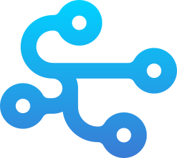
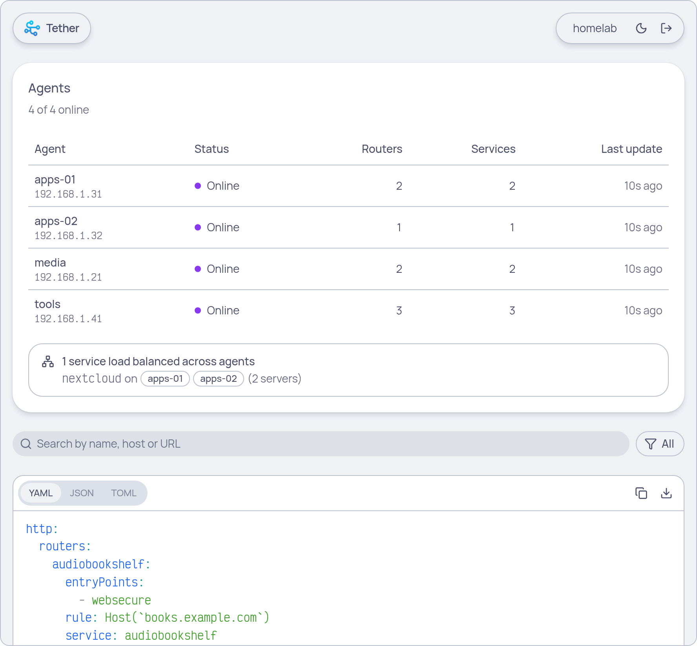

<p align="center">

<br><br>


</p>

# Tether

**Tether** is the central hub for your distributed Traefik setup. It gathers information from all your servers and tells Traefik exactly how to route traffic to your apps.

Think of it as a **central operator**: multiple servers (running [Tetherd](https://github.com/MizuchiLabs/tetherd)) tell Tether which apps are running, and Tether gives Traefik a single, master list of all of them.

<picture>
  <source media="(prefers-color-scheme: dark)" srcset="./.github/screenshots/dashboard-dark.png">
  
</picture>

## Why use Tether?

If you have multiple physical servers or VPS instances but don't want the complexity of Kubernetes or Docker Swarm, Tether is for you.

- **One Public IP:** Point your router/firewall (Port 443) to just **one** server running Traefik.
- **Auto-Discovery:** Apps on other servers are automatically found and added to Traefik.
- **Simple:** No complex networking, no KV stores (Consul/Redis). Each agent keeps one WebSocket connection to Tether and pushes changes over it.

## The "One IP, Many Servers" Setup

Imagine you have 3 servers, but only one public WAN connection.

1. **Server A (The Gateway):** Runs **Traefik** and **Tether**. Your router forwards port 443 here.
2. **Server B & C (The Workers):** Run your apps (Websites, APIs, etc.) and a small agent called [Tetherd](https://github.com/MizuchiLabs/tetherd).

Tetherd on Server B/C tells Tether (on Server A) what is running. Traefik asks Tether for the config and magically knows to send `app1.com` to Server B and `app2.com` to Server C.

## Quick Start

Run Tether using Docker Compose:

```yaml
services:
  tether:
    image: ghcr.io/mizuchilabs/tether:latest
    ports:
      - 3000:3000
    environment:
      - TETHER_PASSWORD=your-password # For the web UI
      - TETHER_API_TOKEN=your-api-token # For agents and Traefik, at least 32 characters
    restart: unless-stopped
```

### Configure Traefik

Tell your Traefik instance to get its routing rules from Tether:

```yaml
providers:
  http:
    endpoint: "http://tether:3000/config"
    pollInterval: "5s"
    headers:
      Authorization: "Bearer your-api-token"
```

## Configuration

| Env Var                  | Flag                | Default             | Description                                                                              |
| ------------------------ | ------------------- | ------------------- | ---------------------------------------------------------------------------------------- |
| `TETHER_PORT`            | `--port`            | `3000`              | Port Tether listens on.                                                                  |
| `TETHER_NO_WEB`          | `--no-web`          | `false`             | Disable serving the web UI.                                                              |
| `TETHER_CONFIG`          | `--config`          | `/data/dynamic.yml` | Optional local file for manual Traefik rules.                                            |
| `TETHER_DEBUG`           | `--debug`           | `false`             | Enable detailed logging.                                                                 |
| `TETHER_UPSTREAMS`       | `--upstream`        |                     | Other Traefik HTTP providers to merge in, as `name=url`. Comma separated or repeated.    |

## Sign in

Tether uses [nushi](https://github.com/mizuchilabs/nushi) for sign in. You open the web UI with a password or through an OIDC provider. Agents, Traefik and scripts send an API token as `Authorization: Bearer <token>`. Sign in settings are env vars only.

| Env Var                                                                                         | Description                                                                                                                  |
| ----------------------------------------------------------------------------------------------- | ---------------------------------------------------------------------------------------------------------------------------- |
| `TETHER_PASSWORD`                                                                               | Password for the web UI, at least 12 characters.                                                                             |
| `TETHER_API_TOKEN`                                                                              | Token for agents and Traefik, at least 32 characters. Comma separated to give agents their own or to roll to a new one.      |
| `TETHER_OIDC_ISSUER`, `TETHER_OIDC_CLIENT_ID`, `TETHER_OIDC_CLIENT_SECRET`, `TETHER_PUBLIC_URL` | Sign in through a provider such as PocketID instead of a password. The callback is `<PUBLIC_URL>/api/session/oidc/callback`. |
| `TETHER_OIDC_GROUP`                                                                             | Optional, only this group from the provider gets in.                                                                         |
| `TETHER_TRUSTED_PROXIES`                                                                        | Proxy IPs or ranges, such as the subnet of Traefik's docker network. Without it any proxy on a private network is trusted.   |

- Make a token with `openssl rand -hex 32`.
- The web UI takes the API token too. To skip the login page, have your reverse proxy add `Authorization: Bearer <token>`. Anyone who reaches that proxy is then signed in.
- API tokens need a password or OIDC next to them. Without either, Tether only answers on localhost.
- The password, the token and the client secret can sit in a file, such as a docker secret. Add `_FILE` to the var, as in `TETHER_API_TOKEN_FILE=/run/secrets/tether_token`.
- Every token works for every agent. Separate tokens let you lock one agent out, but an agent can still report itself under another agent's name.

See the [nushi README](https://github.com/mizuchilabs/nushi#readme) for OIDC providers and running behind a proxy.

### Moving from v0.7

v0.8.0 replaces `TETHER_TOKEN` with the settings above.

1. Make a token of at least 32 characters. Set it as `TETHER_API_TOKEN` on Tether, as `TETHERD_TOKEN` on every agent, and in Traefik's provider header.
2. Set `TETHER_PASSWORD` for the web UI, or the OIDC settings.
3. Remove `TETHER_TOKEN` and `TETHER_TOKEN_FILE`. Tether doesn't start while either is set.
4. If you set `TETHER_TRUSTED_PROXIES` to `direct`, `cloudflare` or `traefik`, replace it with IPs or ranges, or remove it.

## Healthcheck

The image has no shell, so use the built-in `health` command. It exits 0 while the server answers on `/healthz`.

```yaml
    healthcheck:
      test: ["CMD", "tether", "health"]
      interval: 30s
      timeout: 5s
      start_period: 5s
```

## How it behaves

- **Stateless.** Tether keeps everything in memory and never writes files. Agents push their config again when they reconnect.
- **Restarts.** For the first 15s after start, `/config` returns `503`. Traefik keeps its last config during that window while agents reconnect, so routes don't flap.
- **Offline agents.** When an agent disconnects, its routes stay for 30s. If it doesn't come back, they are removed so Traefik stops sending traffic to a dead host.
- **Load balancing.** Run the same app on several machines with the same labels and Tether load balances across them. An HTTP service is shared when every agent routes to it with identical routers (same rule, entrypoints, middlewares, TLS) and the service settings match apart from the servers. Unrelated apps that happen to share a name have different routers, so they are never merged. TCP and UDP are never shared. An offline agent leaves a shared service right away since the others still serve it.
- **Name collisions.** If two sources define the same router, service or middleware name differently, the first one wins: the local file first, then agents sorted by name. Skipped entries are shown in the UI.
- **Upstreams.** Traefik only takes one HTTP provider. To use Tether next to another one, like Pangolin, point Tether at it with `TETHER_UPSTREAMS=pangolin=http://pangolin:3001/api/v1/traefik-config` and point Traefik at Tether. Tether polls each upstream every 5s and treats it like an agent with that name.
- **Local file.** Mount the directory instead of the single file if you want edits picked up live. Editors replace files on save and a single-file bind mount doesn't see that.

---

**Next Step:** Install [Tetherd](https://github.com/MizuchiLabs/tetherd) on your other servers to start connecting them!

## License

Apache 2.0 License - see [LICENSE](LICENSE) for details
